# Pet Shower Control

Aplicativo Flutter para organizar agendamentos de banho, tosa e outros
serviços de um pet shop. Os dados são sincronizados com o Cloud Firestore e
cada conta autenticada mantém sua própria agenda.

## Objetivo e tema

Centralizar a agenda, os dados dos tutores e dos pets, o acompanhamento dos
atendimentos e um resumo financeiro da rotina do estabelecimento.

## Funcionalidades dos trabalhos

### Trabalho 1 — Gestão de agendamentos

- Cadastro e consulta de agendamentos com dados do tutor, pet, serviço,
  profissional, data, horário, preço e observações.
- Edição e exclusão com confirmação.
- Atualização de status: `Aguardando`, `Em Banho`, `Pronto` e `Entregue`.
- Agenda diária, filtros por status e métricas de atendimentos.
- Relatório financeiro, distribuição de serviços e diretório de clientes.

### Trabalho 2 — Autenticação

- Cadastro, login e recuperação de senha por e-mail com Firebase Authentication.
- Verificação da sessão ao iniciar o app e proteção da área interna.
- Logout e mensagens amigáveis para erros comuns de autenticação.

### Trabalho 3 — Persistência e isolamento no Firestore

- CRUD de agendamentos persistidos no Cloud Firestore.
- Atualização em tempo real da lista por `snapshots()`.
- Dados armazenados por usuário autenticado, usando o UID da sessão.
- Estados de carregamento, lista vazia, erro de leitura e falhas de gravação.
- Regras de segurança com validação de proprietário, campos e tipos.

## Tecnologias e dependências

- Flutter e Dart.
- Firebase Core e Firebase Authentication.
- Cloud Firestore.
- Provider para gerenciamento de estado.
- Material 3 e `intl` para interface e formatação em português.

## Organização do código

```text
lib/
├── main.dart
├── firebase_options.dart
├── models/
│   └── appointment_model.dart
├── providers/
│   └── appointment_provider.dart
├── screens/
│   ├── auth_gate.dart
│   ├── login_screen.dart
│   ├── register_screen.dart
│   ├── forgot_password_screen.dart
│   ├── home_screen.dart
│   ├── add_appointment_screen.dart
│   └── reports_screen.dart
└── services/
    ├── auth_service.dart
    └── appointment_repository.dart
```

## Estrutura do Firestore

Cada agendamento fica na subcoleção do usuário autenticado:

```text
users/{uid}/appointments/{appointmentId}
```

Os documentos contêm `ownerUid`, os dados do tutor e do pet, serviço,
profissional, `dateTime`, `status`, `price`, `notes`, `createdAt` e
`updatedAt`. O UID não é solicitado em nenhum formulário: o repositório obtém
essa identidade da sessão autenticada.

## Configuração e execução

### Pré-requisitos

- Flutter SDK compatível com a versão do Dart indicada em `pubspec.yaml`.
- Projeto Firebase com os aplicativos/plataformas configurados.
- Firebase Authentication com o provedor `Email/Password` habilitado.
- Cloud Firestore criado no projeto Firebase.

### Passos

1. Configure o projeto Firebase e os arquivos/opções de plataforma. O projeto
   já inclui `lib/firebase_options.dart` e a configuração Android.
2. No Firebase Console, habilite **Authentication → Email/Password**.
3. Crie o banco de dados **Cloud Firestore**.
4. Na raiz do repositório, publique as regras incluídas:

   ```bash
   firebase deploy --only firestore:rules
   ```

   O `firebase.json` aponta para `firestore.rules`. Não use regras abertas;
   a aplicação depende das regras por UID descritas abaixo.
5. Instale as dependências e execute:

   ```bash
   flutter pub get
   flutter run
   ```

6. Valide o projeto com:

   ```bash
   flutter analyze
   flutter test
   ```

## Segurança e isolamento

O arquivo `firestore.rules` concede leitura e gravação somente quando a sessão
está autenticada e `request.auth.uid` corresponde ao `{userId}` do caminho.
As regras validam os campos permitidos, os tipos dos valores, o proprietário e
os status conhecidos. Atualizações preservam `createdAt`; exclusões verificam
o proprietário do documento. Caminhos fora da subcoleção autorizada são
negados por padrão.

### Relato dos testes com duas contas

Os testes manuais foram realizados e validados com duas contas autenticadas
distintas:

- **Conta A:** cadastrou agendamentos na própria coleção e confirmou que eles
  aparecem na lista.
- **Conta B:** acessou a própria agenda e visualizou somente os documentos
  associados ao seu UID.
- **Isolamento:** a conta B não conseguiu ler, editar ou excluir documentos da
  conta A. As operações de acesso cruzado foram negadas pelas Firestore
  Security Rules; os dados da conta A permaneceram isolados.

### Transcrição das Firestore Security Rules publicadas

Estas são as regras publicadas no projeto Firebase e mantidas em
[`firestore.rules`](firestore.rules):

```text
rules_version = '2';

service cloud.firestore {
  match /databases/{database}/documents {
    function isOwner(userId) {
      return request.auth != null && request.auth.uid == userId;
    }

    function validAppointment(data, userId) {
      return data.keys().hasAll([
          'ownerUid',
          'clientName',
          'clientPhone',
          'petName',
          'petType',
          'petBreed',
          'petSize',
          'serviceName',
          'groomerName',
          'dateTime',
          'status',
          'price',
          'notes',
          'createdAt',
          'updatedAt'
        ]) &&
        data.keys().hasOnly([
          'ownerUid',
          'clientName',
          'clientPhone',
          'petName',
          'petType',
          'petBreed',
          'petSize',
          'serviceName',
          'groomerName',
          'dateTime',
          'status',
          'price',
          'notes',
          'createdAt',
          'updatedAt'
        ]) &&
        data.ownerUid == userId &&
        data.clientName is string &&
        data.clientName.size() > 0 &&
        data.clientName.size() <= 120 &&
        data.clientPhone is string &&
        data.petName is string &&
        data.petName.size() > 0 &&
        data.petName.size() <= 120 &&
        data.petType is string &&
        data.petBreed is string &&
        data.petSize is string &&
        data.serviceName is string &&
        data.groomerName is string &&
        data.dateTime is timestamp &&
        data.status in ['Aguardando', 'Em Banho', 'Pronto', 'Entregue'] &&
        data.price is number &&
        data.price >= 0 &&
        data.notes is string &&
        data.notes.size() <= 2000 &&
        data.createdAt is timestamp &&
        data.updatedAt is timestamp;
    }

    match /users/{userId}/appointments/{appointmentId} {
      allow read: if isOwner(userId);
      allow create: if isOwner(userId) &&
        validAppointment(request.resource.data, userId);
      allow update: if isOwner(userId) &&
        validAppointment(request.resource.data, userId) &&
        request.resource.data.createdAt == resource.data.createdAt;
      allow delete: if isOwner(userId) &&
        resource.data.ownerUid == userId;
    }
  }
}
```

## Screenshots e evidências do CRUD

As capturas abaixo mostram o cadastro, a lista atualizada após a leitura,
a edição, a confirmação e o resultado da exclusão, além do estado sem
agendamentos para a data selecionada.

### CREATE — agendamento cadastrado

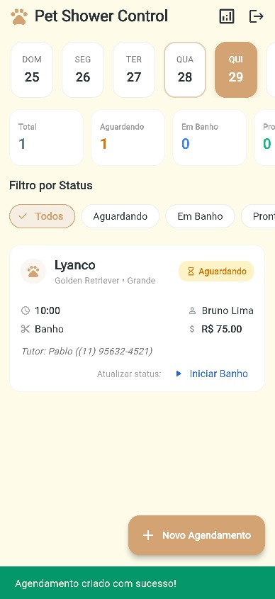

### READ — agendamento exibido na lista


### UPDATE — dados do agendamento atualizados

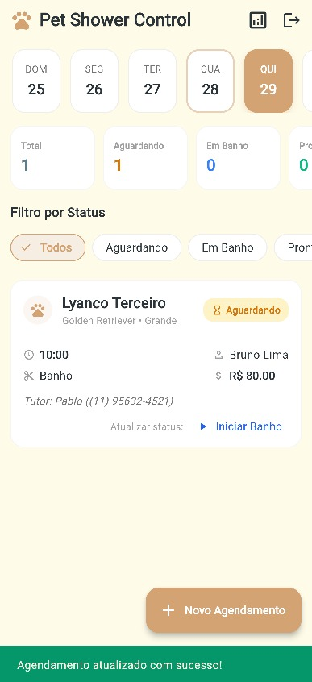

### DELETE — confirmação

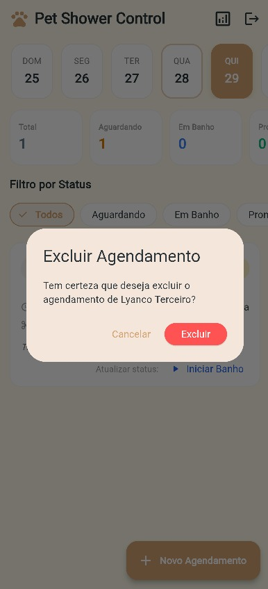

### DELETE — agendamento removido da lista

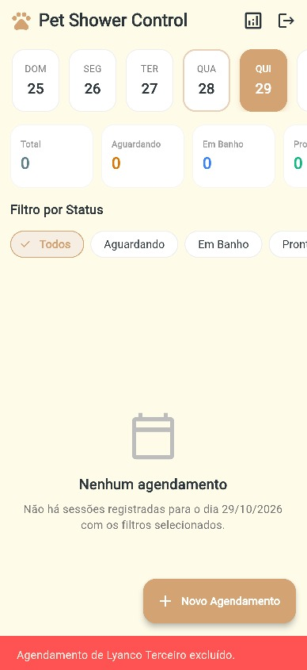

### Estado vazio

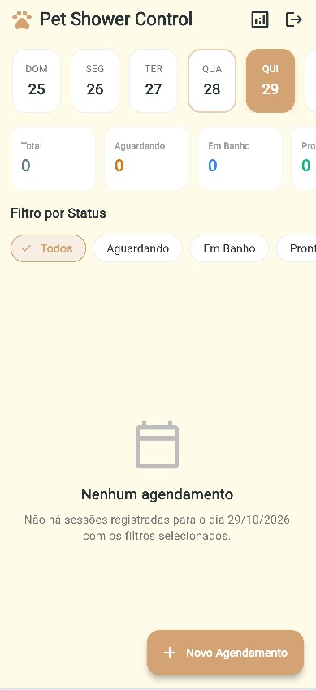

As capturas comprovam os estados visuais mostrados. Para demonstrar também a
persistência após reabrir o aplicativo e o isolamento entre contas, execute os
testes com duas contas no projeto Firebase configurado para a entrega.

### Screenshots dos trabalhos anteriores

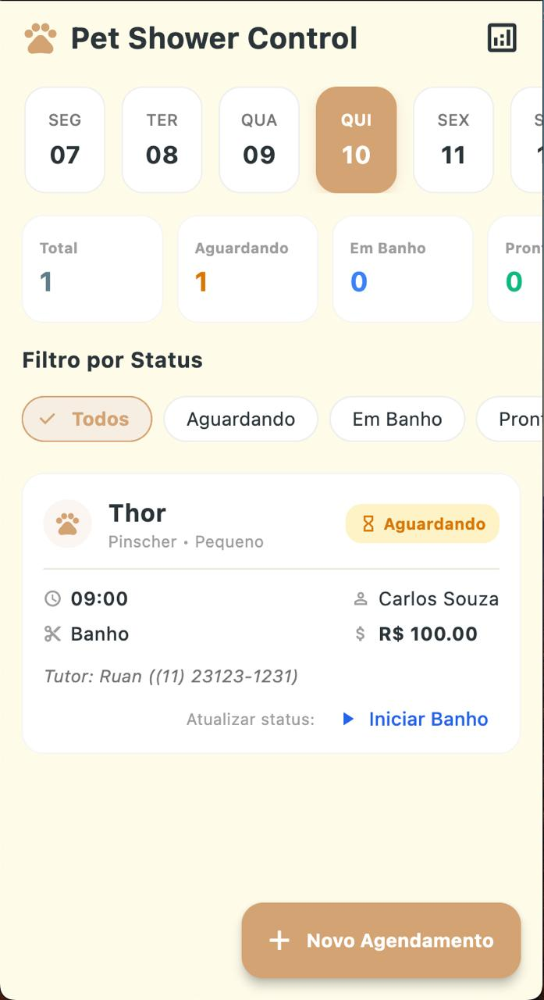
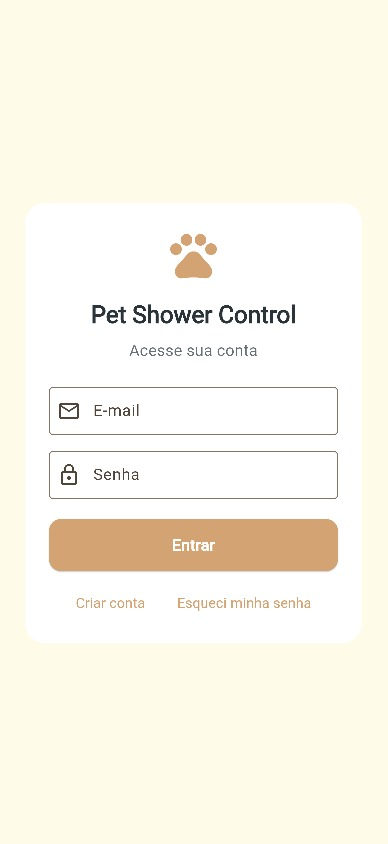
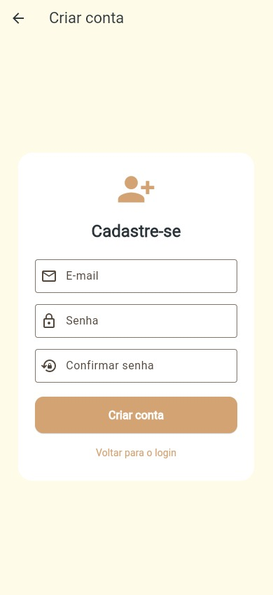
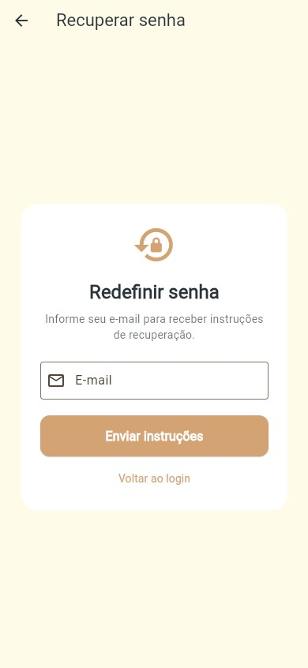
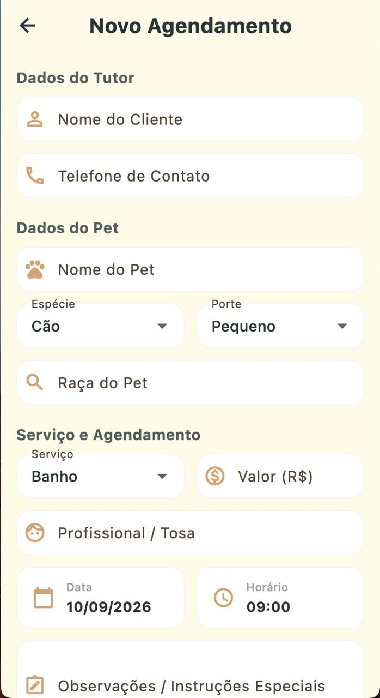
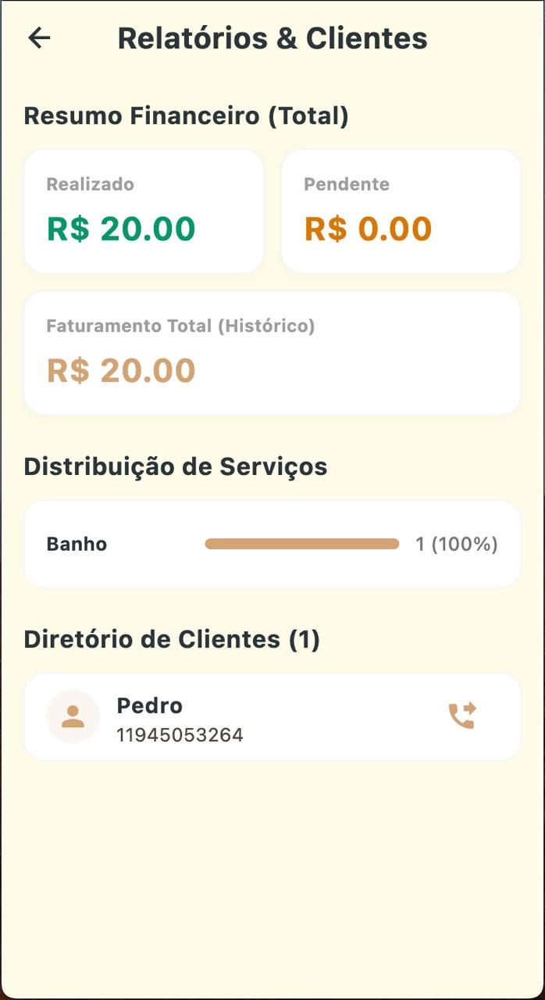
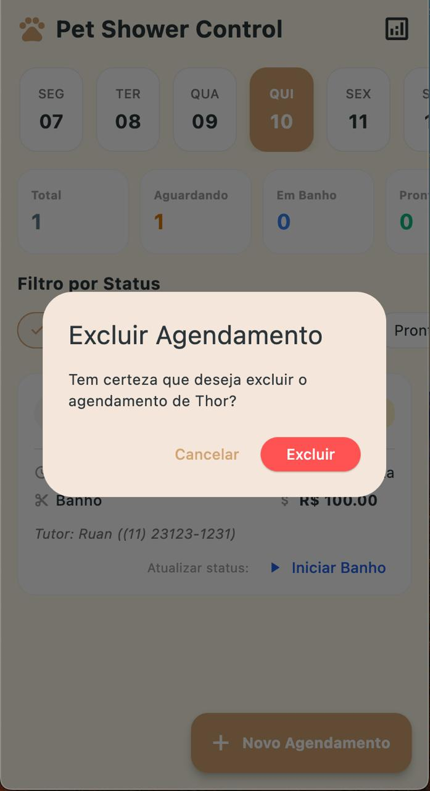
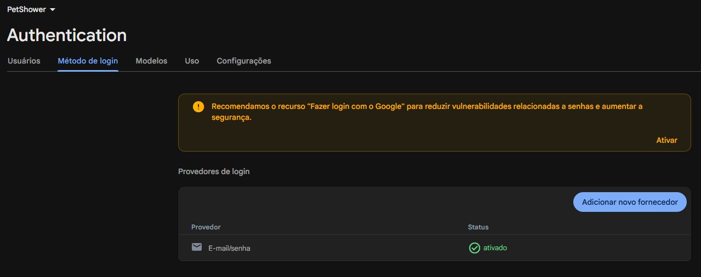

## Próximas evoluções — Trabalho 4

- Perfis e permissões para diferentes profissionais do pet shop.
- Notificações e lembretes para tutores e equipe.
- Integração com calendário e envio de confirmações.
- Cadastro separado de clientes, pets, serviços e profissionais.
- Relatórios por período e exportação/backup de dados.
